<div align="center">

# CrackIt

**A full-stack interview-preparation tracker. Define your own targets, then track study time,
learning, practice, job applications and interviews in one place, with analytics that show
whether you're actually making progress.**

[](https://github.com/mahfuzhasanreza/CrackIt/actions/workflows/ci.yml)


[](./LICENSE)

[Features](#features) · [Architecture](#architecture) · [Getting started](#getting-started) ·
[Screenshots](#screenshots) · [Testing](#testing) · [Deployment](#deployment) · [License](#license)

<br />

<picture>
  <source media="(prefers-color-scheme: dark)" srcset="docs/screenshots/dashboard-dark.png" />
  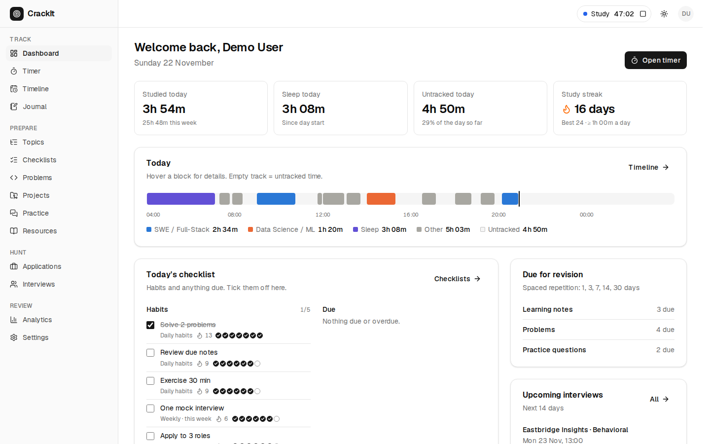
</picture>

</div>

---

## Table of contents

- [Why CrackIt](#why-crackit)
- [Features](#features)
- [Screenshots](#screenshots)
- [Tech stack](#tech-stack)
- [Architecture](#architecture)
  - [System overview](#system-overview)
  - [Layered modules](#layered-modules)
  - [Request lifecycle](#request-lifecycle)
  - [Data model](#data-model)
  - [Domain rules enforced by the database](#domain-rules-enforced-by-the-database)
- [Project structure](#project-structure)
- [Getting started](#getting-started)
- [Configuration](#configuration)
- [Scripts](#scripts)
- [Testing](#testing)
- [CI/CD](#cicd)
- [Deployment](#deployment)
- [Security](#security)
- [Using the app](#using-the-app)
- [License](#license)

---

## Why CrackIt

Interview prep tends to be spread across spreadsheets, LeetCode, a notes app and a calendar,
which makes simple questions hard to answer:

- _How many hours did I really study for SWE this month?_
- _Which topics am I weak on, and what is due for revision today?_
- _Which applications are waiting on me, and how is my funnel converting?_

CrackIt puts all of it in one app. Each user defines their own **tracks** (for example
_SWE / Full-Stack_ or _Data Science / ML_, both available as optional templates), and every
minute, note, problem and application can be tied back to them.

## Features

| Area                  | What you get                                                                                                                                                                                        |
| --------------------- | --------------------------------------------------------------------------------------------------------------------------------------------------------------------------------------------------- |
| **Tracks & topics**   | Your own targets with a topic roadmap up to 4 levels deep. Progress is computed from leaf topics (not started → learning → revising → confident); time rolls up to parent topics.                   |
| **Time tracking**     | One-click timer stored server-side, so it survives closing the tab or switching devices. Manual entries, a timeline view, day summaries. Optional phone notification with a **Stop** button.        |
| **Journal**           | One entry per logical day: mood, sleep (bed/wake times) and learning notes. Notes come back for **spaced-repetition** revision at +1, +3, +7, +14 and +30 days.                                     |
| **Problems**          | Coding problems with attempts, time spent, solve status and revision scheduling. Shared tags with learning notes.                                                                                   |
| **Projects**          | Portfolio projects you're building for your applications.                                                                                                                                           |
| **Practice**          | Practice questions on the spaced-repetition schedule, and mock presentations with a score trend (last 5 vs. the 5 before).                                                                          |
| **Resources**         | Books, courses and videos with unit-based progress (chapters, lessons, …); status follows progress automatically.                                                                                   |
| **Checklists**        | One-off checklists and recurring daily/weekly **habits** with streaks.                                                                                                                              |
| **Job hunt**          | Applications on a drag-and-drop **kanban** (mouse, touch and keyboard, plus a "Move to" menu), an event history per application, an interview **calendar**, interview outcomes and mock interviews. |
| **Goals & analytics** | Daily/weekly/monthly goals; charts for hours per track, sleep, focus, untracked time and the application funnel over 7 days to 12 months, each with a table view.                                   |
| **Guest mode**        | "Continue as guest" on the login page: a private, throwaway account filled with demo data, no sign-up needed. Deleted after 24 hours.                                                               |
| **Data ownership**    | Full JSON backup and restore (into any CrackIt account), CSV export of time entries, problems and applications.                                                                                     |
| **Polish**            | Installable PWA, dark mode, keyboard shortcuts (press <kbd>?</kbd>), responsive down to 360 px.                                                                                                     |

## Screenshots

<table>
  <tr>
    <td width="50%">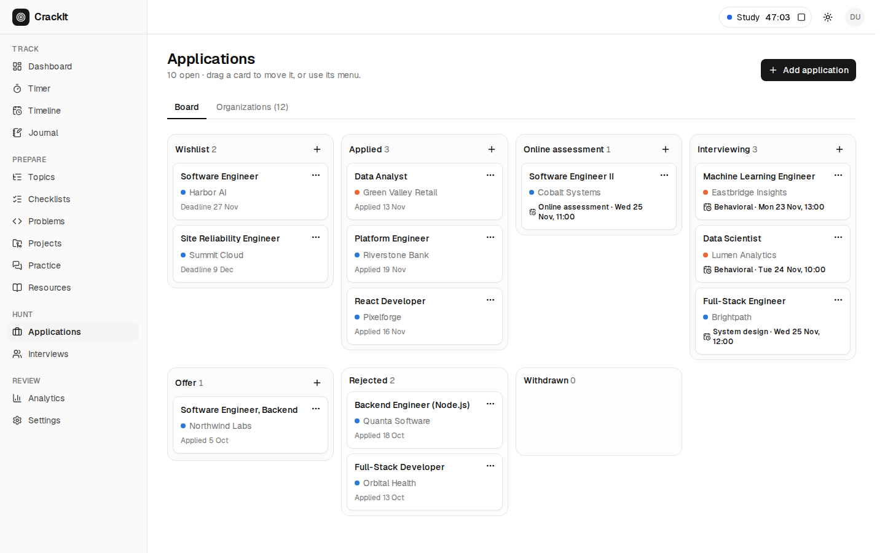<p align="center"><b>Job hunt</b> — drag-and-drop pipeline</p></td>
    <td width="50%">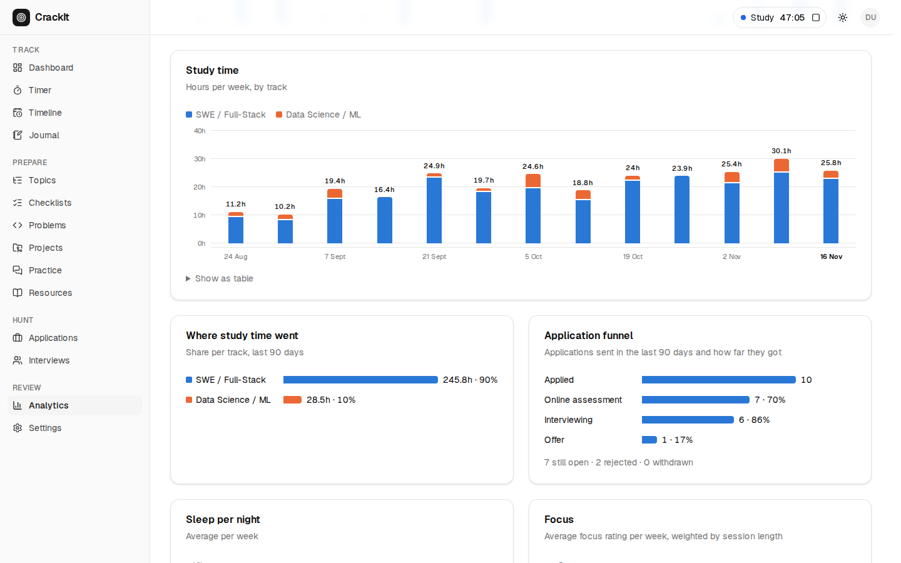<p align="center"><b>Analytics</b> — hours per track, application funnel</p></td>
  </tr>
  <tr>
    <td>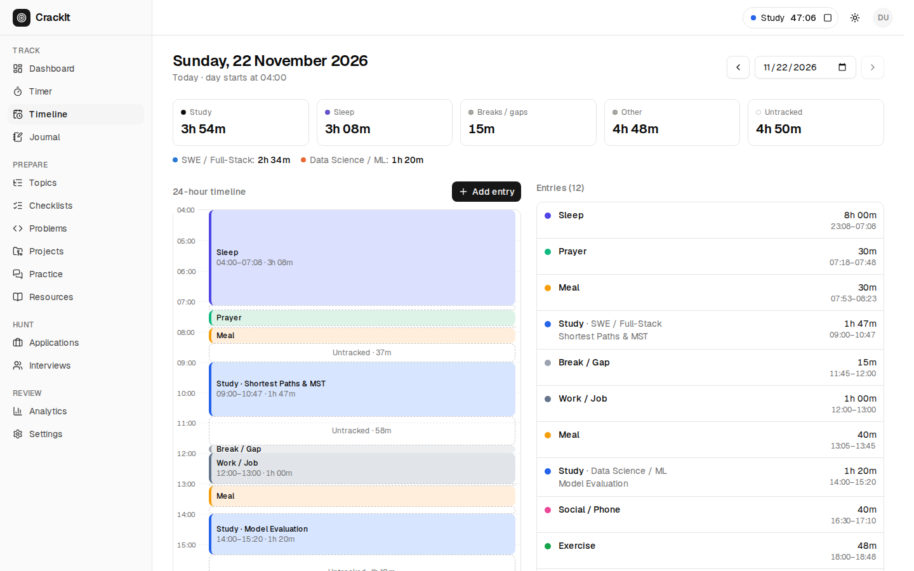<p align="center"><b>Timeline</b> — every minute of the day</p></td>
    <td>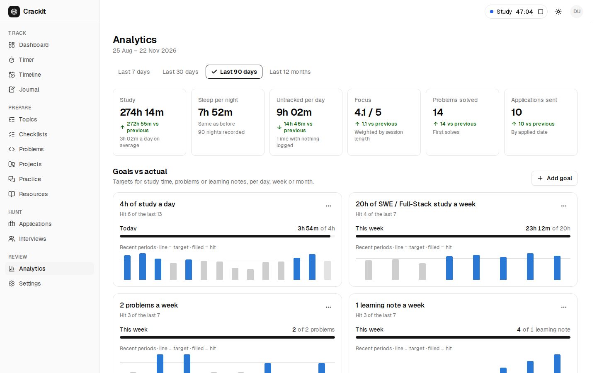<p align="center"><b>Goals</b> — targets vs. actual</p></td>
  </tr>
  <tr>
    <td>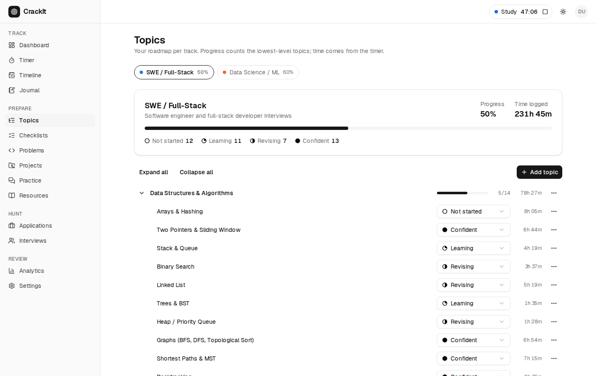<p align="center"><b>Topics</b> — roadmap progress per track</p></td>
    <td>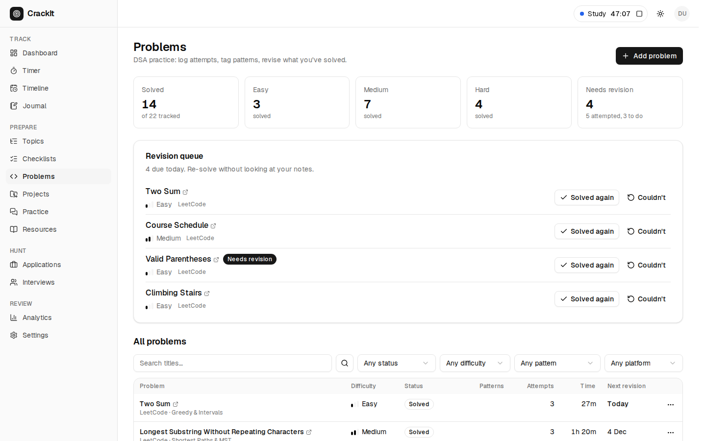<p align="center"><b>Problems</b> — revision queue</p></td>
  </tr>
  <tr>
    <td>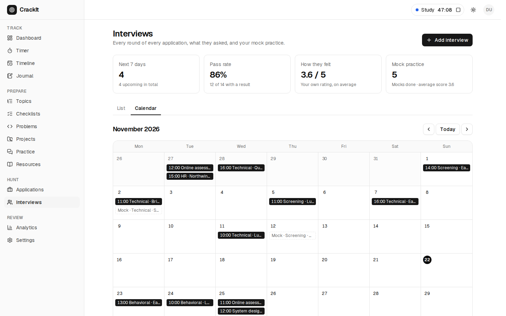<p align="center"><b>Interviews</b> — calendar and pass rate</p></td>
    <td>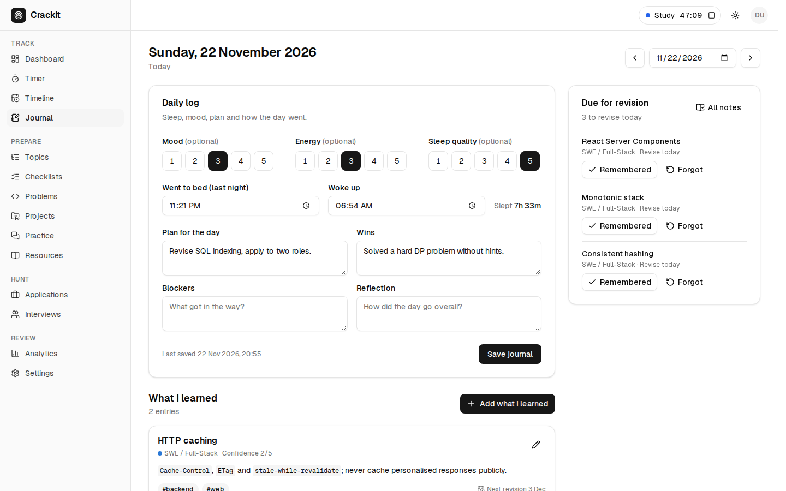<p align="center"><b>Journal</b> — daily log and revisions</p></td>
  </tr>
</table>

<p align="center">
  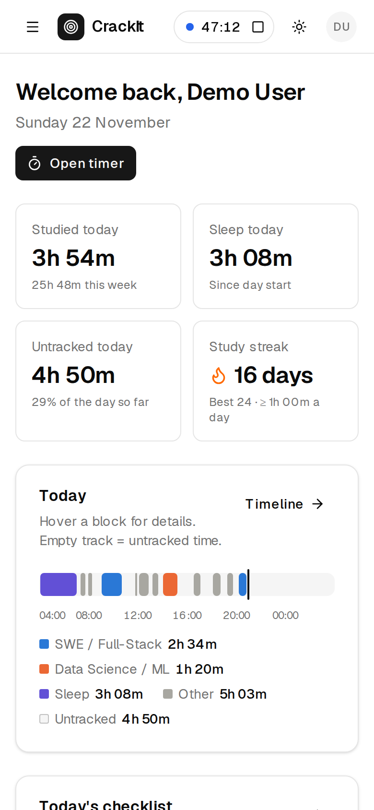<br />
  <b>On a phone</b> — installable PWA, responsive down to 360 px
</p>

All screenshots use a demo account with made-up data. To regenerate them after a UI change:
`pnpm db:up && pnpm build && pnpm screenshots` (see [`scripts/screenshots/`](./scripts/screenshots)).

## Tech stack

| Layer           | Technology                                                                                                        |
| --------------- | ----------------------------------------------------------------------------------------------------------------- |
| Framework       | [Next.js 16](https://nextjs.org) (App Router, Turbopack, Cache Components, Server Actions), React 19              |
| Language        | TypeScript (strict, no `any`)                                                                                     |
| Database        | PostgreSQL 16 with [Prisma 7](https://www.prisma.io) (`@prisma/adapter-pg`)                                       |
| Auth            | [Auth.js v5](https://authjs.dev) Credentials provider, JWT sessions, argon2id password hashing                    |
| Validation      | [Zod v4](https://zod.dev) on every input                                                                          |
| UI              | Tailwind CSS v4, [shadcn/ui](https://ui.shadcn.com) (Radix), lucide icons, sonner toasts, next-themes, `@dnd-kit` |
| Testing         | Vitest + Testing Library (unit and integration), Playwright (end-to-end)                                          |
| Tooling         | pnpm, ESLint (flat config), Prettier, Husky + lint-staged, commitlint (Conventional Commits)                      |
| Hosting & CI/CD | Vercel (app) + Neon (Postgres, branch per preview), GitHub Actions, Docker image for any other container host     |

## Architecture

CrackIt is a **modular monolith**: one deployable, split into feature modules with the same
strict layers. It is simple to run and debug, and the module boundaries keep features
independent.

### System overview

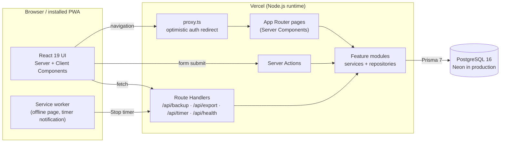

### Layered modules

Every feature lives in `src/modules/<feature>/` and follows the same layering. Only
repositories import the Prisma client.

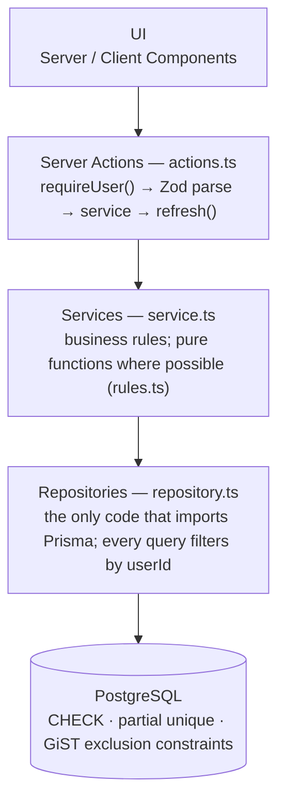

| File                      | Responsibility                                                                   |
| ------------------------- | -------------------------------------------------------------------------------- |
| `validators.ts`           | Zod schemas for every form and payload                                           |
| `actions.ts`              | `"use server"` entry points: auth, validation, call the service, return a result |
| `service.ts` / `rules.ts` | Business rules (pure functions where possible), returning `Result<T>`            |
| `repository.ts`           | Database access via Prisma, always scoped by `userId`                            |
| `components/`             | Feature UI                                                                       |
| `*.test.ts`               | Unit tests (no DB) · `*.int.test.ts`: integration tests against Postgres         |

**Modules:** `analytics`, `auth`, `backup`, `checklists`, `dashboard`, `goals`, `jobs`,
`journal`, `practice`, `problems`, `projects`, `resources`, `settings`, `tags`,
`time-tracking`, `tracks-topics`.

### Request lifecycle

A form submission, for example starting a timer:

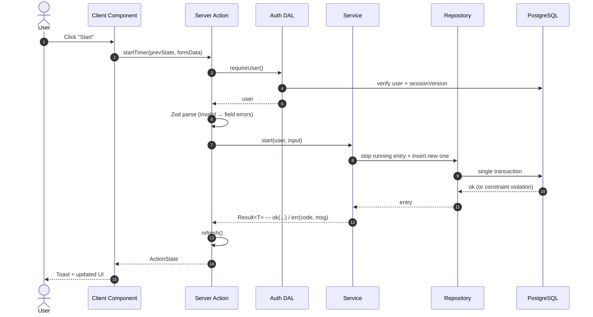

### Data model

26 Prisma models, all owned by a user (every table has `userId`, `createdAt`, `updatedAt`).
Simplified relationships:

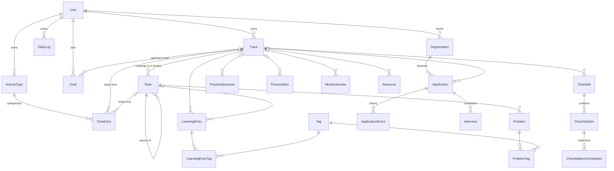

Not shown: `Project`, plus the auth tables `LoginAttempt` and `SignupAttempt` (rate limiting).
The full schema is in [`prisma/schema.prisma`](./prisma/schema.prisma).

### Domain rules enforced by the database

Important rules are checked in the service layer **and** enforced by PostgreSQL, so a bug in
application code can't corrupt data:

| Rule                                                        | Database mechanism                         |
| ----------------------------------------------------------- | ------------------------------------------ |
| At most one running timer per user                          | Partial unique index (`ended_at IS NULL`)  |
| Time entries never overlap                                  | GiST exclusion constraint on a `tstzrange` |
| `ended_at > started_at`, entries ≤ 24 h                     | CHECK constraints                          |
| One journal entry per user per logical day                  | Unique (`user_id`, `date`)                 |
| Habits ⇔ recurrence ≠ NONE                                  | CHECK constraint                           |
| Solved / needs-revision problems have a `solved_at`         | CHECK constraint                           |
| Leaving WISHLIST records `applied_on`                       | CHECK constraint                           |
| Resource progress ≤ total; start/finish dates match status  | CHECK constraints                          |
| Study-minute goals may be scoped to a track, others may not | CHECK constraint                           |

**Time and "logical days".** All timestamps are stored as `timestamptz` (UTC). Each user has a
timezone and a `dayStartHour`, so studying until 2 AM counts toward the previous day. All date
math lives in one tested module, [`src/lib/dates.ts`](./src/lib/dates.ts) (DST-safe).

## Project structure

```text
CrackIt/
├── .github/workflows/      # ci.yml · deploy.yml (smoke tests) · backup.yml (nightly pg_dump)
├── e2e/                    # Playwright specs, fixtures and DB setup
├── prisma/
│   ├── schema.prisma       # 26 models
│   ├── migrations/         # SQL migrations (incl. hand-written constraints)
│   ├── seed.ts             # dev user + defaults
│   └── seed-defaults.ts    # idempotent seeding of tracks, topics, activity types
├── public/                 # PWA icons, sw.js, offline.html
├── docs/screenshots/       # README screenshots (generated by `pnpm screenshots`)
├── scripts/                # create-user, reset-password, generate-icons, screenshots/
├── src/
│   ├── app/
│   │   ├── (auth)/         # /login, /register
│   │   ├── (app)/          # authenticated pages (dashboard, timer, journal, …)
│   │   ├── api/            # auth, backup, export, health, timer route handlers
│   │   └── manifest.ts     # PWA manifest
│   ├── components/         # app shell, charts, shared UI (shadcn in ui/)
│   ├── hooks/
│   ├── lib/                # env, db, result, dates, palette, spaced repetition, tags
│   ├── modules/<feature>/  # validators · actions · service · repository · components · tests
│   ├── auth.ts             # Auth.js configuration
│   └── proxy.ts            # Next.js 16 proxy (formerly middleware)
├── test/                   # integration test helpers and factories
├── docker-compose.yml      # Postgres dev (:5433), Postgres test (:5434), Adminer (:8080)
├── Dockerfile              # standalone app image + migrate target
└── vercel.json
```

### Routes

| Route           | Purpose                                                                                       |
| --------------- | --------------------------------------------------------------------------------------------- |
| `/dashboard`    | Today at a glance: stats, last 7 days, week goals, habits, due revisions, upcoming interviews |
| `/timer`        | Timer and time entries                                                                        |
| `/timeline`     | Day-by-day timeline of tracked time                                                           |
| `/journal`      | Daily log, sleep, learning notes and revisions                                                |
| `/topics`       | Track roadmaps and topic progress                                                             |
| `/problems`     | Coding problems, attempts and revisions                                                       |
| `/projects`     | Portfolio projects                                                                            |
| `/practice`     | `?tab=questions\|presentations`                                                               |
| `/resources`    | Books, courses and other learning resources                                                   |
| `/checklists`   | Checklists and habits                                                                         |
| `/applications` | Applications: list, kanban board (`?view=board`), organizations                               |
| `/interviews`   | Interviews and mocks (`?view=calendar&month=YYYY-MM`)                                         |
| `/analytics`    | Charts and KPIs (`?range=7d\|30d\|90d\|12m`)                                                  |
| `/settings`     | `?tab=general\|tracks\|activities\|data`                                                      |
| `/api/health`   | Liveness + database ping (`{ status, db, time }`)                                             |

## Getting started

### Prerequisites

- **Node.js ≥ 22** (see [`.nvmrc`](./.nvmrc))
- **pnpm 9** (`corepack enable`)
- **Docker** with the Compose plugin (local PostgreSQL)

### Installation

```bash
git clone https://github.com/mahfuzhasanreza/CrackIt.git
cd CrackIt

pnpm install                       # also generates the Prisma client
cp .env.example .env               # then set AUTH_SECRET (openssl rand -base64 32)

pnpm db:up                         # Postgres :5433 (dev), :5434 (test), Adminer :8080
pnpm db:deploy                     # apply migrations
pnpm db:seed                       # dev user + default tracks, topics, activity types
pnpm dev                           # http://localhost:3000
```

### Signing in

- Seeded dev user: **`dev@crackit.local`** / **`crackit-dev-password`**
- Or click **Continue as guest** on the login page for a throwaway account full of demo data
- Or sign up at <http://localhost:3000/register> (new accounts pick their own tracks or start
  from a template)
- Or create an account from the CLI:

```bash
pnpm user:create --email you@example.com --name "Your Name" [--starter-tracks]  # prompts for a password (12+ chars)
pnpm user:reset-password --email you@example.com                                  # also signs out all sessions
```

## Configuration

Environment variables are validated at startup by [`src/lib/env.ts`](./src/lib/env.ts) (Zod).
Add any new variable there **and** to [`.env.example`](./.env.example).

| Variable                | Required  | Description                                                                   |
| ----------------------- | --------- | ----------------------------------------------------------------------------- |
| `DATABASE_URL`          | Yes       | Postgres connection string (pooled URL in production)                         |
| `AUTH_SECRET`           | Yes       | Secret used to sign JWTs — `openssl rand -base64 32`                          |
| `DIRECT_URL`            | Prod only | Direct (unpooled) URL used by `prisma migrate`                                |
| `DATABASE_URL_UNPOOLED` | Prod only | Set by the Neon–Vercel integration; used for migrations if `DIRECT_URL` unset |
| `TEST_DATABASE_URL`     | Tests     | Database for integration tests (`:5434`)                                      |
| `SEED_USER_EMAIL`       | No        | Email of the seeded dev user (default `dev@crackit.local`)                    |
| `SEED_USER_PASSWORD`    | No        | Password of the seeded dev user (dev only, ≥ 12 chars)                        |

## Scripts

| Command                                                | Purpose                                                        |
| ------------------------------------------------------ | -------------------------------------------------------------- |
| `pnpm dev`                                             | Development server on <http://localhost:3000>                  |
| `pnpm build` / `pnpm start`                            | Production build / serve                                       |
| `pnpm check`                                           | Lint + typecheck + format check + unit tests (run before a PR) |
| `pnpm lint` / `pnpm lint:fix`                          | ESLint                                                         |
| `pnpm typecheck`                                       | `next typegen` + `tsc --noEmit`                                |
| `pnpm format` / `pnpm format:check`                    | Prettier (with Tailwind class sorting)                         |
| `pnpm test` / `pnpm test:watch` / `pnpm test:coverage` | Unit tests (Vitest)                                            |
| `pnpm test:int`                                        | Integration tests against the test database                    |
| `pnpm test:e2e`                                        | Playwright end-to-end tests (run `pnpm build` first)           |
| `pnpm screenshots`                                     | Regenerate the README screenshots (run `pnpm build` first)     |
| `pnpm db:up` / `pnpm db:down`                          | Start / stop local Postgres via Docker                         |
| `pnpm db:migrate -- --name <name>`                     | Create and apply a migration in development                    |
| `pnpm db:generate`                                     | Regenerate the Prisma client (needed after `db:migrate`)       |
| `pnpm db:deploy`                                       | Apply pending migrations (CI / production)                     |
| `pnpm db:seed` / `pnpm db:reset` / `pnpm db:studio`    | Seed / reset / browse the dev database                         |
| `pnpm user:create` / `pnpm user:reset-password`        | Manage accounts from the command line                          |

## Testing

CrackIt uses three levels of tests:

| Level           | Files           | Runs against                           | Command                       |
| --------------- | --------------- | -------------------------------------- | ----------------------------- |
| **Unit**        | `*.test.ts(x)`  | Pure logic — no database               | `pnpm test`                   |
| **Integration** | `*.int.test.ts` | Services against real Postgres (:5434) | `pnpm db:up && pnpm test:int` |
| **End-to-end**  | `e2e/*.spec.ts` | Production build + test database       | `pnpm build && pnpm test:e2e` |

- Integration tests create a fresh user per test with `createTestUser()` from
  [`test/factories.ts`](./test/factories.ts), so no cleanup is needed.
- E2E fixtures and users are in [`e2e/fixtures.ts`](./e2e/fixtures.ts); the database is reset by
  [`e2e/setup-db.ts`](./e2e/setup-db.ts).
- Every service has unit tests for its business rules, and every bug fix gets a regression test.

## CI/CD

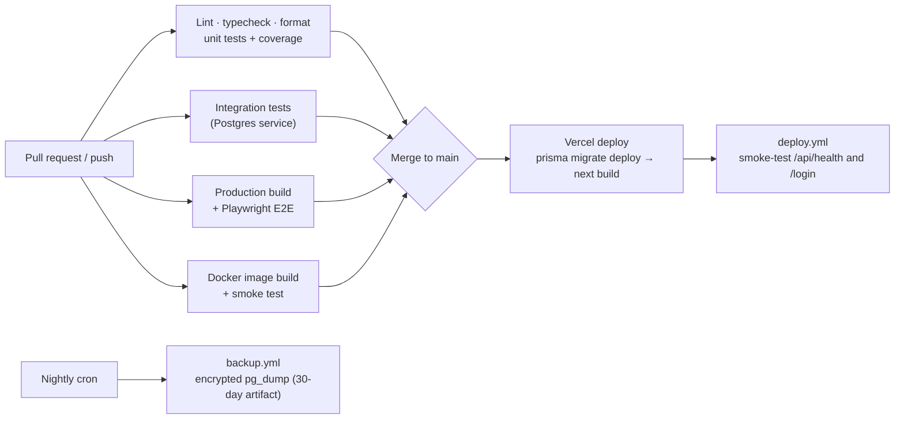

| Workflow                                       | Trigger                  | What it does                                                   |
| ---------------------------------------------- | ------------------------ | -------------------------------------------------------------- |
| [`ci.yml`](./.github/workflows/ci.yml)         | Every PR and push        | Quality checks, integration tests, E2E, Docker image           |
| [`deploy.yml`](./.github/workflows/deploy.yml) | Vercel deployment status | Smoke-tests `/api/health` and `/login` on the deployed URL     |
| [`backup.yml`](./.github/workflows/backup.yml) | Nightly + manual         | Encrypted `pg_dump` of production, kept as a workflow artifact |

## Deployment

### Vercel + Neon (recommended)

Merging to `main` deploys to production; every PR gets a preview deployment with its own Neon
database branch. Vercel runs `pnpm vercel-build` (`prisma migrate deploy && next build`), so
migrations are applied before a deployment goes live.

**One-time setup**

1. **Vercel** — import the GitHub repository (framework and build command come from
   [`vercel.json`](./vercel.json)).
2. **Neon** — in Vercel → Integrations, add **Neon** and connect it with _"Create a database
   branch for each preview deployment"_ enabled. It sets `DATABASE_URL` (pooled) and
   `DATABASE_URL_UNPOOLED` (direct, used by migrations) for Production and every preview.
3. **Environment variables** — in Vercel → Settings → Environment Variables (Production and
   Preview), set `AUTH_SECRET` (`openssl rand -base64 32`; use a different value for Preview).
4. **First user** — sign up at `/register`, or from your machine:
   ```bash
   DATABASE_URL="<Neon direct URL>" pnpm user:create --email you@example.com [--starter-tracks]
   ```
5. **GitHub secrets** (Settings → Secrets and variables → Actions):
   - `BACKUP_DATABASE_URL` — the Neon production _direct_ URL, and `BACKUP_PASSPHRASE` — a long
     random passphrase (keep a copy in your password manager). Used by the nightly backup.
   - _Optional_ `VERCEL_AUTOMATION_BYPASS_SECRET` (Vercel → Deployment Protection → Protection
     Bypass for Automation) to smoke-test protected preview deployments too.

> [!IMPORTANT]
> Migrations must be backward compatible with the running code (add first, remove in a later
> deploy): a migration can succeed while the build after it fails, leaving the old code live.

### Docker (any container host)

```bash
docker build -t crackit .                              # Next.js server (standalone output)
docker build --target migrate -t crackit-migrate .     # runs `prisma migrate deploy`

docker run --rm -e DATABASE_URL crackit-migrate
docker run -p 3000:3000 -e DATABASE_URL -e AUTH_SECRET crackit
```

CI builds both images and smoke-tests them against Postgres.

## Security

- **Passwords** hashed with argon2id; changing the password bumps `sessionVersion`, which signs
  out every session.
- **Rate limiting** — login: 5 failures per email per 15 minutes and 20 per IP; sign-up: 5
  attempts per IP per hour; guest accounts: 10 per IP per hour.
- **Guest isolation** — every guest gets their own account (no shared demo login whose password
  anyone could change), with a random password that is never shown. Guests use a reserved email
  domain that sign-up refuses, and accounts older than 24 hours are deleted with all their data.
- **Authorization on the server** — `proxy.ts` only does optimistic redirects; every page,
  Server Action and Route Handler re-checks the user with `requireUser()`, and every query is
  scoped by `userId`.
- **Validated input** — Zod on every form, action and API payload; environment variables are
  validated at startup.
- **Safe import/export** — backup import validates the file and gives every row a fresh id
  before replacing data in one transaction (a crafted file can't reference another user's
  rows); CSV export escapes formula injection.
- **User content** — markdown is rendered without raw HTML.
- **PWA** — the service worker never caches user data; it only serves an offline page.

## Using the app

- **Install it on your phone** — open the site in Chrome (Android) → menu → _Install app_, or in
  Safari (iOS) → Share → _Add to Home Screen_. It opens full-screen like a native app. On
  Chromium browsers, an **Install app** button also appears at the bottom of the sidebar.
- **Keyboard shortcuts** — press <kbd>?</kbd> anywhere for the list (<kbd>g</kbd> then a letter
  jumps to a page, <kbd>s</kbd> stops the timer).
- **Timer notification** — on phones, enable it per device in Settings → General to get a
  notification with a **Stop** button while the timer runs.
- **Your data** — Settings → Data downloads a full JSON backup (restorable into any CrackIt
  account, e.g. when moving from local to production) and CSVs of time entries, problems and
  applications.

## License

Released under the [MIT License](./LICENSE). © 2026 Mahfuz Hasan Reza.

---

<div align="center">
Built by <a href="https://github.com/mahfuzhasanreza">@mahfuzhasanreza</a>
</div>
